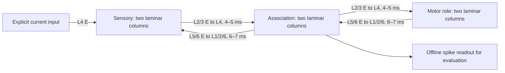

# Continuous laminar simulation

This implementation is a **small, inspectable model of selected cortical
mechanisms**, not a reconstruction of a human brain. `neurogen/biology.py`
advances continuously without token boundaries, backpropagation, or task labels.
An optional supervised observer reads spikes without changing the network. Neither
the simulator's activity nor its anatomical labels establish thought, intelligence,
consciousness, predictive coding, or humanlike cognition.

## Research basis and modeling commitments

| Evidence | Implemented mechanism | Boundary of the claim |
|---|---|---|
| [Gerstner et al., *Neuronal Dynamics*, integrate-and-fire models](https://neuronaldynamics.epfl.ch/online/Ch1.S3.html) and [conductance synapses](https://neuronaldynamics.epfl.ch/online/Ch3.S1.html) | Leaky membrane, threshold events, refractory period, separate excitatory/inhibitory reversal potentials | Point neurons; no action-potential waveform, dendritic compartments, ion-channel kinetics, NMDA or glia |
| [Potjans & Diesmann, cortical microcircuit model](https://arxiv.org/abs/1106.5678) | Layer-dependent excitatory/inhibitory populations and recurrent connectivity | Inspiration for population structure; we do not reproduce their connectivity matrix, full-scale circuit or empirical firing-rate fit |
| [Bastos et al., 2012](https://pmc.ncbi.nlm.nih.gov/articles/PMC3777738/) | Superficial feedforward projections and deep feedback projections, with different termination layers | Routing constraints only; no implemented prediction-error objective, cortical frequency claim, or validated hierarchy |
| [Bi & Poo, 1998](https://www.gatsby.ucl.ac.uk/~pel/course_wuhan/papers/bi.poo_1998.pdf) | Excitatory potentiation/depression depending on arrival versus postsynaptic spike order | Their experiment used cultured hippocampal neurons. This is a simplified pair rule, not a universal human cortical plasticity rule |
| [Vogels et al., 2011](https://spiral.imperial.ac.uk/entities/publication/f3199cc9-f28b-41ef-8850-7a32e16402e0) | Inhibitory plasticity toward a postsynaptic firing-rate target | Applied to I→E contacts; numerical rates and conductance bounds are engineering parameters |
| [Turrigiano et al., 1998](https://www.nature.com/articles/36103) | Multiplicative incoming excitatory weight scaling in response to activity | Accelerated control law; no claim to reproduce the observed biological timescale |
| [Butz & van Ooyen, 2013](https://journals.plos.org/ploscompbiol/article?id=10.1371/journal.pcbi.1003259) | Activity-constrained contact formation and removal | Our correlation ranking and finite candidate pool differ from their homeostatic spine/bouton growth model |
| [Maass, Natschläger & Markram, 2002](https://pubmed.ncbi.nlm.nih.gov/12433288/) | Continuous recurrent dynamics probed by a separate supervised readout | Readout accuracy is a measure of accessible information, not proof that Hebbian learning solved a task |
| [Bellec et al., 2020](https://www.nature.com/articles/s41467-020-17236-y) | Research basis for the next credit-assignment comparison | E-prop is **not implemented**; its eligibility and learning signals must not be equated with the current STDP traces |

There is no universally established, identical cortical-column unit across
regions or species. [Horton & Adams (2005)](https://pmc.ncbi.nlm.nih.gov/articles/PMC1569491/)
document the ambiguity in column definitions. Here, a column is a spatially
localized collection of laminar E/I populations, with horizontal and vertical
connections. The boundaries, neuron counts and probabilities are explicit
downscaling choices. Calling these "true human cortical columns" would overstate
the evidence.

## Anatomy and pathways

Each column contains 64 cells:

| Layer | Excitatory | Inhibitory |
|---|---:|---:|
| L1 | 0 | 2 |
| L2 | 8 | 2 |
| L3 | 8 | 2 |
| L4 | 12 | 3 |
| L5 | 12 | 3 |
| L6 | 10 | 2 |

Default: two columns in each of three regions, totaling 384 cells (300 E, 84 I).
`sensory`, `association`, and `motor` are **software roles**, not validated models
of specific human cortical areas. In particular, applying the same granular
six-layer template to the motor role does not capture agranular motor cortex.
L1 contains only simplified inhibitory cells; no apical dendrites are modeled.

Local potential contacts favor L4→L2/L3, L2→L3, L3→L5, L5→L6 and L6→L4.
Same-layer recurrence and weaker other local pathways remain. Inhibitory axons
are confined to their column, preferentially within one layer of their origin.
Horizontal excitatory pathways connect adjacent columns in the same region.
Only declared regional projections are allowed; there is no global broadcast.



`BiologyConfig.regions`, `columns_per_region` and `projections` define the module
graph. Potential contacts are sampled once. Actual synapses are the active subset,
initially sampled at probability 0.65 with at most 48 incoming and 80 outgoing
contacts per cell. Growth can activate unused potential contacts, and pruning
can deactivate existing ones; both change actual event transmission. This is
structural contact plasticity within existing potential axons, not unbounded
axon growth or neurogenesis. No autapses or duplicate pre/post contacts exist.

## Dynamics and units

All cells advance synchronously, normally every 1 ms. Supported timesteps are
0.25, 0.5 and 1 ms. Delays are integer multiples of those steps. One tick uses:

```text
C dV/dt = gL(EL - V) + ge(Ee - V) + gi(Ei - V) - w + Iexternal
ge, gi decay exponentially; arriving spikes add positive conductance
w decays exponentially; excitatory spikes add an adaptation current
```

Voltage is mV, time ms, current pA, capacitance pF, conductance nS. Defaults:
`EL = reset = -65`, `threshold = -50`, `Ee = 0`, `Ei = -80`, `gL = 10`;
`C_E = 200`, `C_I = 100`; excitatory/inhibitory conductance decay 5/10 ms;
adaptation decay 200 ms and E spike increment 15 pA; refractory duration 2 ms.
Membrane integration is exact for conductances held constant within a tick,
with operator splitting for decays and events. Spike times are discretized.
This is adaptive LIF, **not** the exponential AdEx spike-onset model.

Conductance weights remain nonnegative. Presynaptic cell identity determines
which reversal potential applies (a Dale-like constraint), so no learning step
turns an excitatory neuron into an inhibitory one. Default E contact weights
start at 1.2–2 nS (feedforward regional contacts multiplied by 1.5); I weights
start at 4–6 nS. Weight limits are 0.01–4 nS for E and 0.01–12 nS for I.

Every cell also receives **explicit external Poisson background excitation**:
800 events/s of 0.5 nS by default. This represents unresolved afferents, not
spontaneous thought or proof of self-sustaining cortical dynamics. Setting
`background_hz=0` exposes dependence on that drive; an unstimulated resting
network remains silent. The demo applies 250 pA to one column's L4 E cells for
50 ms every 250 ms, alternating columns. There is no hidden fallback activation.

Emission captures the current contact weight into a bounded event ring. Events
arrive after their axonal delay, so later learning cannot retroactively change
an emitted event's amplitude. Pruning cancels that contact's pending events.
Arrival traces, not undelayed source spikes, determine STDP. Refractory state,
adaptation and synaptic conductance persist across stimuli and idle periods.

## Local learning and structural change

Pre-arrival and postsynaptic traces decay with a 20 ms time constant. On each
tick, decay old traces, compute weight changes, then insert new events. This
avoids imposing an arbitrary order on simultaneous events. For an active
excitatory contact with weight `g`, pre-arrival `p`, post spike `s`, and old
traces `x_pre`, `x_post`:

```text
Δg_E = η_E [x_pre s (4 - g) - 1.05 x_post p g]
Δg_I = η_I [p (x_post - α) + x_pre s], α = 2 target_Hz × 0.020 s
```

The inhibitory rule applies only to I→E contacts. Default `η_E=.005`,
`η_I=.002`, target 5 Hz. A one-second exponentially filtered postsynaptic rate
also scales incoming E magnitudes by
`exp((target-rate)/target × dt/scaling_tau)`, with `scaling_tau=100 s` and a
per-step exponent bound of ±0.001. Bounds and a refractory period constrain
activity but do not prove dynamical stability or realistic statistics.

Potential contacts track delayed presynaptic events even while inactive. An
exponential average of pre-trace × post-spike estimates causal coactivity.
Every 500 ms, an inactive E contact can grow when coactivity is at least .001,
the postsynaptic rate is below 1.5×target, and fan-in/out budgets permit it.
Only one incoming contact per postsynaptic cell can grow per interval. New
contacts start at 0.3 nS. Eligible contacts are ranked by local coactivity.

After a 5-second grace period, an E contact can be pruned when coactivity is
below .001 and its weight is below 0.1 nS **or** its filtered arrival rate is
below 0.1 Hz. Active inhibition is structurally preserved in this version.
These are accelerated engineering rules; numerical timing is not a model of
human spine turnover. There is no dopamine signal, reward objective, or
behavioral credit assignment. Local correlation alone need not improve a task.

## Persistence, measurement and reproducibility

The CPU simulator uses sparse edge lists and bounded delay/history rings. It
stores no growing autograd graph or unbounded in-memory spike history. The runner streams
windowed metrics to JSONL, reporting Hz by region, layer and E/I population,
silent fraction, maximum per-cell rate, conductance means and synapse turnover.
It records raw spike events and per-neuron rates to CSV, and renders the charts
listed in [README.md](README.md). The live cue observer logs real prediction
accuracy and cross-entropy; unlabeled modes report these as unavailable.
Disk usage grows with duration; working buffers are bounded. `--realtime` paces
to wall time when computation is fast enough; it is not a hard real-time guarantee.

Pickle-free `.npz` checkpoints atomically save all neural and synaptic arrays,
topology, in-flight events, traces, structural age, counters, private Poisson RNG,
clock, configuration, demo protocol and optional cue-observer state. Loading
validates the format and topology. Changing the topology generator requires a
format migration.
SIGINT finishes the current tick before saving; a hard kill can recover the last
periodic checkpoint. No loop is left running by the benchmark.

`benchmark_biology.py` separates three questions:

1. Does the isolated local rule produce the intended timing curve? This is a
   mechanism check, not evidence of learned behavior.
2. Does a sensory intervention causally change downstream spikes under matched
   background noise, and does cutting regional connections remove that effect?
3. Can a fixed-regularization supervised readout identify which sensory column
   was stimulated from **later association spikes**? Does plasticity help versus
   a frozen core and a disconnected control?

The task uses 40 balanced training trials and 20 disjoint balanced test trials,
randomized with an independent fixed protocol seed. Each trial lasts 250 ms;
the sensory pulse occupies 0–50 ms, and association E spikes during 50–150 ms
form the features. Neural state never resets. All synaptic changes freeze for
test trials. Readout centering/scaling and ridge fitting use training data only;
test labels never enter the network. Three initialization/noise seeds are reported
without choosing a best seed or tuning readout regularization on test data.

New measurements are written under `runs/`; no archived result is required.
The live observer uses online softmax training with recurring 40-train/20-evaluation
blocks, unlike the offline ridge benchmark above. In the live mode, evaluation
labels do not update the observer, while the core continues unsupervised adaptation.
Accuracy belongs to the observer, not to a biological loss function. Passing tests
does not establish a human-brain simulation. Before adding more regions or
modalities, demonstrate durable task improvement from local credit assignment,
longer memory, resistance to interference, and stability over longer runs and
different timesteps/input regimes. Anatomical detail alone cannot supply those
properties.
